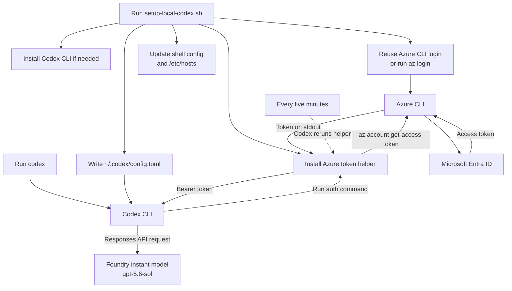

# Local Codex setup (no Docker)

The local workflow installs Codex and configures a Microsoft Foundry instant-access model with Microsoft Entra authentication in one command.

> **Instant access:** Create the Foundry resource and project in **West US 3** for this setup. Codex uses `gpt-5.6-sol` by model name, so no separate model deployment is required.

## Prerequisites

- Azure CLI
- Node.js and npm
- `sudo` access for the `/etc/hosts` update
- A Microsoft Foundry project in West US 3 with the Foundry User role

## Run setup

Copy the project endpoint from Foundry, replace the placeholder below, and run:

```bash
AZURE_AI_PROJECT_ENDPOINT=https://RESOURCE-NAME.services.ai.azure.com/api/projects/PROJECT-NAME \
./local/scripts/setup-local-codex.sh
```

The default model is the instant-access model `gpt-5.6-sol`; no deployment is required. Instant access is currently in preview and limited to Foundry projects in West US 3. See [Microsoft's supported-model list](https://learn.microsoft.com/azure/foundry/concepts/instant-models#supported-models) for current availability.

If Azure CLI is not signed in, the command starts `az login`. If Codex is not installed, it installs `@openai/codex` with npm.

After setup completes, run:

```bash
codex
```

For repeatable setup, copy the example environment file once, fill in its values, and rerun the same setup script:

```bash
cp local/.env.example local/.env
```

The scripts load repo-root `.env` first and `local/.env` second, so local values take precedence.

## How local Codex works



## Token refresh configuration

Setup installs `~/.codex/bin/fetch-azure-openai-token.sh` and writes this provider authentication block to `~/.codex/config.toml`:

```toml
[model_providers.azure.auth]
command = "/home/you/.codex/bin/fetch-azure-openai-token.sh"
refresh_interval_ms = 300000
timeout_ms = 5000
```

Codex calls the helper without stdin. The helper requests the `https://ai.azure.com/.default` scope with `az account get-access-token`, writes the token to stdout, and Codex proactively requests a new token every five minutes. This follows the [official command-backed authentication configuration](https://learn.chatgpt.com/docs/config-file/config-advanced#custom-model-providers).

Optional environment overrides:

```env
AZURE_AI_PROJECT_ENDPOINT=https://RESOURCE-NAME.services.ai.azure.com/api/projects/PROJECT-NAME
AZURE_OPENAI_MODEL=gpt-5.6-sol
AZURE_AI_TOKEN_SCOPE=https://ai.azure.com/.default
CODEX_MODEL_REASONING_EFFORT=high
CODEX_AZURE_AUTH_REFRESH_INTERVAL_MS=300000
CODEX_AZURE_AUTH_TIMEOUT_MS=5000
```

## What setup changes

- `~/.codex/bin/fetch-azure-openai-token.sh`: installed credential helper.
- `~/.codex/config.toml`: Azure model provider and auth settings.
- `~/.bashrc`: managed `codex-launch` environment block.
- `/etc/hosts`: refreshed entry for the host in `AZURE_AI_PROJECT_ENDPOINT`.
- `~/.azure-for-codex`: dedicated Azure CLI profile, or a link to an existing `~/.azure` profile.

The setup scripts are idempotent and may be rerun after changing settings.

## Troubleshooting

If Codex returns `401 Unauthorized`, renew the Azure session and retry:

```bash
AZURE_CONFIG_DIR="$HOME/.azure-for-codex" az login
codex
```

To run individual setup components:

```bash
./local/scripts/setup-codex-config.sh
./local/scripts/setup-codex-bashrc.sh
./local/scripts/setup-aoai-hosts.sh
```
